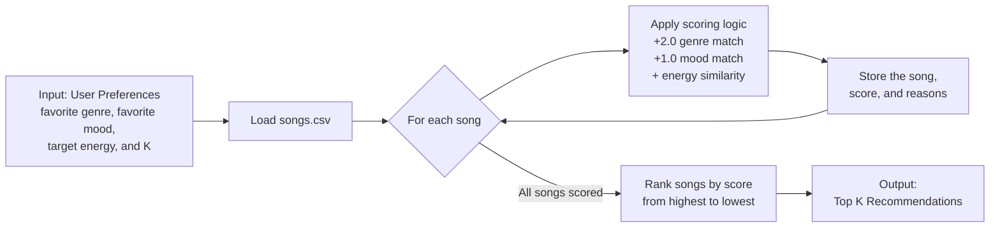

# 🎵 Music Recommender Simulation

## Project Summary

In this project you will build and explain a small music recommender system.

Your goal is to:

- Represent songs and a user "taste profile" as data
- Design a scoring rule that turns that data into recommendations
- Evaluate what your system gets right and wrong
- Reflect on how this mirrors real world AI recommenders

Replace this paragraph with your own summary of what your version does.

---

## How The System Works

Explain your design in plain language.

Some prompts to answer:

- What features does each `Song` use in your system
  - For example: genre, mood, energy, tempo
- What information does your `UserProfile` store
- How does your `Recommender` compute a score for each song
- How do you choose which songs to recommend

You can include a simple diagram or bullet list if helpful.

Real-world recommendation systems combine signals such as listening history,
behavior from similar users, and attributes of the available music. This
simulation uses a simpler content-based approach that compares each song's
genre, mood, energy, tempo, and acousticness with a user profile. My version
prioritizes emotionally expressive ballads, especially songs that feel
romantic, yearning, bittersweet, moody, or melancholic. Because the dataset
does not directly measure lyrical emotion, the simulation approximates this
taste through the `ballad` genre and the available mood labels. A ballad match
receives the most weight, while energy remains flexible because I enjoy both
calm and powerful arrangements. After scoring every song, the system ranks the
songs from highest to lowest score and returns the top matches.

### Data Flow Plan



The input is the user's preference profile. The process loops through every
song in `data/songs.csv`, judges it with the scoring logic, and stores its score
and matching reasons. The output ranks all scored songs and returns the top
`K` recommendations.

### Song Features

Each `Song` stores the attributes available in `data/songs.csv`:

- `id`, `title`, and `artist` identify the song and display the recommendation.
- `genre` and `mood` describe the song categorically.
- `energy`, `tempo_bpm`, `valence`, `danceability`, and `acousticness` describe
  numerical musical characteristics.

The first version of the scoring rule uses `genre`, `mood`, and `energy`. The
remaining attributes can support later experiments without claiming that the
system understands lyrics, vocal emotion, instrumentalness, or beat
consistency.

### User Profile Features

For this simulation, the `UserProfile` stores:

- Favorite genre: `ballad`
- Favorite mood: `romantic`, with melancholic and moody songs also representing
  the broader taste being modeled
- Target energy: `0.45`, with a low scoring weight so calm and powerful songs
  can both rank well
- Target tempo: `75` BPM
- Acoustic preference: `True`

### Finalized Algorithm Recipe

1. Load the songs from `data/songs.csv` and read the user's favorite genre,
   favorite mood, target energy, and requested number of recommendations (`K`).
2. Loop through every song and start its score at `0`.
3. Add **2.0 points** when the song's genre matches the user's favorite genre.
4. Add **1.0 point** when the song's mood matches the user's favorite mood.
5. Add up to **1.0 energy-similarity point** based on how close the song's
   energy is to the user's target energy:

   ```text
   energy similarity = max(0, 1 - abs(song energy - target energy) / 0.5)
   ```

6. Save the song's total score and the reasons it earned points.
7. Sort all songs from highest to lowest score and return the top `K` songs.

### Potential Biases

This system may over-prioritize genre because a genre match is worth twice as
much as a mood match. It may therefore overlook a great song that matches the
user's mood and energy but belongs to a different genre. It also relies on a
small catalog and exact labels, so underrepresented genres and related moods
such as `melancholic` or `moody` may receive less attention.

---

## Getting Started

### Setup

1. Create a virtual environment (optional but recommended):

   ```bash
   python -m venv .venv
   source .venv/bin/activate      # Mac or Linux
   .venv\Scripts\activate         # Windows

2. Install dependencies

```bash
pip install -r requirements.txt
```

3. Run the app:

```bash
python -m src.main
```

### Running Tests

Run the starter tests with:

```bash
pytest
```

You can add more tests in `tests/test_recommender.py`.

---

## Sample Recommendation Output

```text
Loaded songs: 20

==================================================
TOP MUSIC RECOMMENDATIONS
==================================================

1. Sunrise City — Neon Echo
   Final score: 3.96
   Reasons:
     • genre match (+2.0)
     • mood match (+1.0)
     • energy similarity (+0.96)

2. To the Bone — Pamungkas
   Final score: 3.86
   Reasons:
     • genre match (+2.0)
     • mood match (+1.0)
     • energy similarity (+0.86)

3. Gym Hero — Max Pulse
   Final score: 2.74
   Reasons:
     • genre match (+2.0)
     • energy similarity (+0.74)

4. Rooftop Lights — Indigo Parade
   Final score: 1.92
   Reasons:
     • mood match (+1.0)
     • energy similarity (+0.92)

5. Perspective — Cafuné
   Final score: 1.76
   Reasons:
     • mood match (+1.0)
     • energy similarity (+0.76)

==================================================
```

---

## Experiments You Tried

Use this section to document the experiments you ran. For example:

- What happened when you changed the weight on genre from 2.0 to 0.5
- What happened when you added tempo or valence to the score
- How did your system behave for different types of users

---

## Limitations and Risks

Summarize some limitations of your recommender.

Examples:

- It only works on a tiny catalog
- It does not understand lyrics or language
- It might over favor one genre or mood

You will go deeper on this in your model card.

---

## Reflection

Read and complete `model_card.md`:

[**Model Card**](model_card.md)

Write 1 to 2 paragraphs here about what you learned:

- about how recommenders turn data into predictions
- about where bias or unfairness could show up in systems like this


