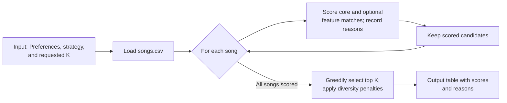

# 🎵 Music Recommender Simulation

## Project Summary

This project implements a content-based music recommender over a 28-song
catalog. It scores core genre, mood, and energy preferences, can use five
optional advanced song attributes, offers four ranking strategies, and applies
diversity penalties while building the top results. Recommendations include
the score reasons in a wrapped terminal table.

Your goal is to:

- Represent songs and a user "taste profile" as data
- Design a scoring rule that turns that data into recommendations
- Evaluate what your system gets right and wrong
- Reflect on how this mirrors real world AI recommenders

---

## How The System Works

Real-world recommenders can use listening history, behavior from similar users,
and details about songs. This simulation is a smaller content-based system. Its
default strategy scores exact genre and mood matches and energy similarity; the
other strategies change the relative weights. Optional advanced preferences
can also match subgenre, mood tags, lyrical theme, instrumentation, and language.
The top-`K` list is selected greedily with artist and non-preferred-genre
diversity penalties. Genre remains a scoring signal, not a hard filter.

### Data Flow Plan



The input includes the user's preferences and selected strategy. The program
scores each song and records match reasons, then iteratively builds the top-`K`
list using adjusted scores and displays the results in a table.

### Song Features

Each `Song` stores the attributes available in `data/songs.csv`:

- `id`, `title`, and `artist` identify the song and display the recommendation.
- `genre` and `mood` describe the song categorically.
- `energy`, `tempo_bpm`, `valence`, `danceability`, and `acousticness` describe
  numerical musical characteristics.
- `subgenre`, `mood_tags`, `lyrical_theme`, `instrumentation_tags`, and
  `language` provide optional, more detailed matching attributes.

The five advanced attributes add one point when a provided preference matches.
Multi-value fields use semicolon-separated tags. An `unknown` value does not
match. These labels are metadata supplied in the CSV; the recommender does not
infer lyrics or audio content itself.

### User Profile Features

For this simulation, the `UserProfile` stores:

- Favorite genre: `ballad`
- Favorite mood: `romantic`
- Target energy: `0.45`

The built-in CLI profiles use these three core fields. A profile can also
provide any of the five advanced preferences; omitted preferences do not affect
the score. Tempo, valence, danceability, and acousticness are stored but are not
currently used for scoring.

### Finalized Algorithm Recipe

1. Load songs and read the user's preferences, selected strategy, and requested
   number of recommendations (`K`).
2. Score each song's core preferences using the selected strategy's weights:
   `current` (genre 1.0, mood 1.0, energy 2.0), `genre-first` (3.0, 1.0,
   0.5), `mood-first` (1.0, 3.0, 0.5), or `energy-focused` (0.5, 0.5, 3.0).
3. Add **1.0 point per matching advanced preference** when provided: subgenre,
   lyrical theme, any matching mood tag, any matching instrumentation tag, or
   any matching language.
4. Energy similarity uses the selected strategy's energy weight:

   ```text
   energy similarity = max(0, 1 - abs(song energy - target energy) / 0.5)
   energy points = strategy energy weight * energy similarity
   ```

5. Build the top-`K` list greedily. Subtract 1.5 for each previously selected
   song by the same artist and 0.5 for each previously selected song from the
   same genre, except the user's preferred genre. Include each deduction in the
   reason text and return adjusted scores.

### Potential Biases

Genre, mood, and advanced attributes rely on exact normalized labels, so related
terms may not match. Genre is a bonus rather than a filter. The diversity rule
can lower repeated-artist and non-preferred-genre scores, while exempting the
preferred genre. Song metadata can be subjective or unverified, and the
catalog remains small compared with a real music service.

---

## Getting Started

### Setup

1. Create a virtual environment (optional but recommended):

   ```bash
   python -m venv .venv
   source .venv/bin/activate      # Mac or Linux
   .venv\Scripts\activate         # Windows
   ```

2. Install dependencies

   ```bash
   pip install -r requirements.txt
   ```

3. Run the app:

   ```bash
   python -m src.main
   ```

   Choose a ranking strategy with `--strategy`: `current`, `genre-first`,
   `mood-first`, or `energy-focused`. For example:

   ```bash
   python -m src.main --strategy mood-first
   ```

   Recommendations display in a wrapped ASCII table with rank, song, artist,
   adjusted score, and the reasons behind each score.

   Top-`K` selection applies an artist-repeat penalty and a smaller repeated-
   genre penalty. The listener's preferred genre is exempt from the genre
   penalty, and explanations show any diversity deductions.

### Running Tests

Run the starter tests with:

```bash
pytest
```

You can add more tests in `tests/test_recommender.py`.

---

## Sample Recommendation Output

```text
Loaded songs: 28
Ranking mode: Current scoring
+-----+--------------------------+--------------------+---------+--------------------------------------------------+
| #   | Song                     | Artist             | Score   | Reasons                                          |
+-----+--------------------------+--------------------+---------+--------------------------------------------------+
| 1   | Example song             | Example artist     | 3.50    | genre match (+1.0); mood match (+1.0); energy... |
+-----+--------------------------+--------------------+---------+--------------------------------------------------+
```

The row is illustrative; scores and reasons depend on the selected profile,
strategy, and catalog metadata. The actual output wraps long table cells.

---

## Experiments You Tried

I tested the Weight Shift: genre went from 2 points to 1, and energy similarity
was doubled. The top-five order changed for Deep Intense Rock and Chill Lofi,
but stayed the same for Ballad / Romantic and High-Energy Pop. The experiment
changed the rankings, but without user feedback or labeled preferences I cannot
say whether they became more accurate. The detailed comparisons and profile
outputs are in the Evaluation section of `model_card.md`.

---

## Limitations and Risks

The catalog has 28 songs and remains small. Genre is a scoring bonus rather
than a filter, and exact labels can miss related preferences. The scorer stores
tempo, valence, danceability, and acousticness but does not use them. It also
does not learn from listening history or feedback, and its recommendations
depend on the accuracy of the CSV metadata.

---

## Reflection

The personal reflection is in `model_card.md`:

[**Model Card**](model_card.md)


